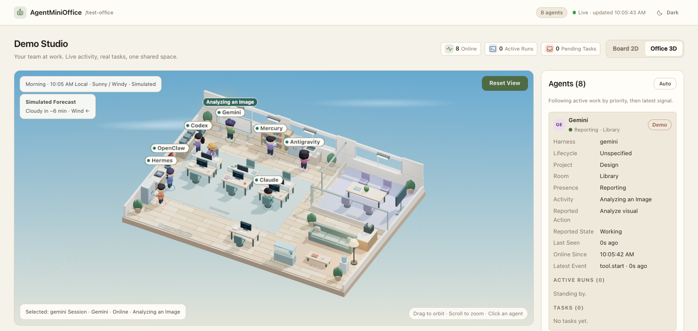
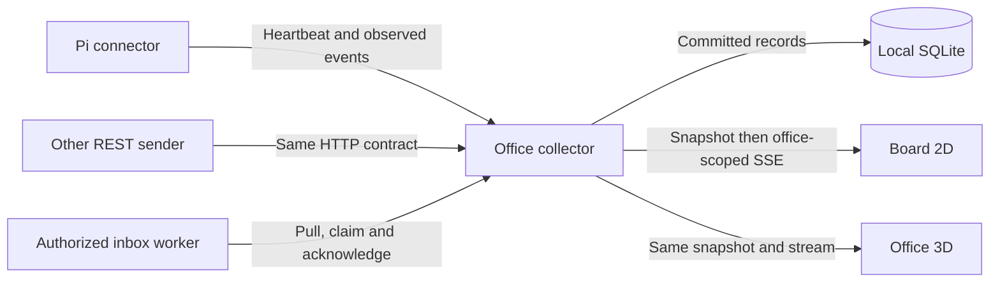

# AgentMiniOffice

**A self-hosted virtual office for AI agents.** See who is online, what each agent last reported, and who is waiting for a human. Use the 2D board for a quick check, or step into the 3D office: a reader turns a page at a cabinet while a planner arranges papers at a desk. Both views follow the same events. Neither one runs the agents.



*An isolated demo with synthetic activity from Pi Agent, Codex, Hermes, Mercury, Gemini, Claude, Antigravity and OpenClaw. These are illustrative names, not a list of native integrations. Pi has a packaged connector; other engines can report through the same REST API.*

[Quick start](#quick-start) · [Build an executable](#build-an-executable) · [Docker](#run-with-docker) · [Office features](#inside-the-office) · [Connect an agent](#connect-an-agent) · [Privacy and operations](#privacy-and-operations)

> [!NOTE]
> **Disclaimer:** This project is 100% AI-assisted and intended for educational purposes only. It will be maintained as a side project in spare time only, with no guarantees of ongoing support, updates, or production readiness.
>
> **No affiliation:** AgentMiniOffice is an independent project. It is not affiliated with, sponsored by, or endorsed by Google (Antigravity or Gemini), Anthropic (Claude), OpenAI (Codex), or the teams behind Pi Coding Agent, Hermes Agent, Mercury Agent or OpenClaw. These names appear in the demo roster only to illustrate different agent harnesses; starting the demo does not contact or run any of them.
>
> Your self-hosted collector stores office and account records, credential verifiers, and the activity metadata your connectors send. If you use the task inbox, it also stores the task text and results you submit. The supplied Pi connector does **not** send conversation transcripts, prompts, tool arguments, command output, file contents, screenshots, or answers to human prompts. Names, project labels and task text are visible data: do not put secrets in them.

## Quick start

Download or clone this repository, open a terminal in its root, and choose **one** runtime. No separate database server, frontend build or model API key is needed.

| | Bun | Node.js |
|---|---|---|
| Requirements | Bun 1.4+ | Node.js 24+ and npm |
| Install | `bun install --frozen-lockfile` | `npm install --include=dev` |
| Start | `bun run start` | `npm run start:node` |
| Develop with reload | `bun run dev` | `npm run dev:node` |

The Node scripts run TypeScript via `tsx`, a development dependency; do not omit it for this install path. Both runtimes use their own built-in SQLite driver. Copy [.env.example](.env.example) to `.env` **only if you want to change the defaults**.

1. Open **[localhost:3000/dashboard](http://127.0.0.1:3000/dashboard)**. On an empty database, create the first Owner account and name the office. Complete setup on loopback before exposing the server.
2. In **Overview → Demo Tools**, choose **8** to see the full roster, select **Start Demo**, then **Open Office → Office 3D**. Click an agent to inspect its activity, drag to orbit, or switch to **Board 2D** to see the same roster by room. No real agent credentials are needed.
3. Choose **Stop Demo** when finished. It removes the panel-created demo agents and their assigned tasks, not your real visitors. To bring a real session into the office, follow [Connect an agent](#connect-an-agent).

Check a running collector with `curl -fsS http://127.0.0.1:3000/health`. Look for `"ok":true`, `"db":"ok"` and either `bun:sqlite` or `node:sqlite`. The dashboard and API use the same port.

### Build an executable

Prefer a binary to a source checkout at runtime? Bun can compile the collector for your current platform. From the repository root:

```sh
mkdir -p dist
bun install --frozen-lockfile
bun build --compile src/index.ts --outfile dist/agentminioffice
./dist/agentminioffice
```

The executable embeds the server code and Bun runtime, **not** the website or database schema. To move it, copy the binary together with `public/`, `docs/SCHEMA.sql` and `package.json`; start it with that directory as its working directory. It creates `data/` on first run. Stop any collector using the same database before switching launch methods.

### Run with Docker

From the repository root, start the [Compose service](docker-compose.yml). It builds the included [Dockerfile](Dockerfile), runs as a non-root user, and publishes only on loopback. No host folder, volume or `.env` file is required.

```sh
docker compose up --build --wait
curl -fsS http://127.0.0.1:3000/health
```

Open the [first-run dashboard](http://127.0.0.1:3000/dashboard). Use `docker compose logs -f office` for diagnostics. If port 3000 is taken, set `OFFICE_HOST_PORT=3100` before starting Compose and open port 3100 instead. Use a TLS reverse proxy for remote access.

To configure the container, set application variables from [.env.example](.env.example) in the project’s `.env`, an explicit `docker compose --env-file <file>`, or the shell. Compose forwards the listed `MINIOFFICE_*` settings; shell values override file values. Paths refer to the container filesystem. Compose fixes `MINIOFFICE_HOST=0.0.0.0` **inside** the container so the published port can reach it. `MINIOFFICE_PORT` controls the internal port and healthcheck; `OFFICE_HOST_PORT` controls the loopback port on the host. Without a file or overrides, both ports default to 3000.

**No mount does not mean no storage.** SQLite and its join-key secret live in `/app/data` inside the container. `docker compose stop` followed by `docker compose start` keeps that data. `docker compose down` or any update that **recreates** the container discards its accounts, office, tasks and activity. For an installation you need to keep, configure a persistent volume at `/app/data` **before first setup**, and back it up as described in [Security](SECURITY.md#credentials).

Prefer Docker without Compose? Use the same image and storage behavior:

```sh
docker build -t agentminioffice:local .
docker run -d --name agentminioffice -p 127.0.0.1:3000:3000 agentminioffice:local
```

## Inside the office

### Two views of the same work

- **Board 2D** groups visitors by reported room. It works without WebGL and is a useful view on small screens or when you just need to spot a blocked session.
- **Office 3D** turns a report into a destination. Avatars walk around furniture, approach chairs from the side and begin their work pose only after arrival. A borrowed desk yields to an agent that needs it for desk work. Select an avatar to see the reported action separately from the physical station.
- **Presence, runs and human attention** are distinct. A visitor can be online and waiting for you, working, or explicitly idle. A reported child run can have its own linked avatar; a tool name alone does not create one. **Waiting for Human is display-only**: answer in the originating harness. Lost signal does not mean success or completion.
- **Tasks and access** live in the dashboard. Members can track task state; authorized workers pull assigned work, claim a lease, then acknowledge or fail it. A panel click never executes a shell command. Owners manage connector admission separately from member accounts and read-only share links.

### Actions, objects and poses

The [action catalogue](public/schemas/action-v1.json) describes **17 semantic actions**. An agent reports what it observed, not animation commands. It can send just `{"action":"read"}` or choose a listed variant such as `{"action":"read","variant":"cabinet_reading"}`.

| Reported work | What you can see in 3D |
|---|---|
| `write`, `web_request`, `use_tools` | Typing at a laptop, tools at a bench or trolley, or a writer making a temporary whiteboard visit. A workshop worker may use a spare laptop without becoming a writer. |
| `read`, `search_content`, `lookup_file`, `search_web` | A book at the shelf, papers at a cabinet or a spare desk. Reading, content search and file lookup can also sort cabinet material, move a mouse or arrange documents. |
| `analyze_visual`, `plan` | An analyst can point at the whiteboard or move a mouse **without typing**. A planner can mark the board or arrange notes at a desk. The label still describes the reported work. |
| `compact_context`, `print`, `call`, `meet` | Sort a book at a filing cabinet, prepare output at the printer, lift the handset or sit at the meeting table. Compaction is shown from a reported hook, not guessed from silence. |
| `final_response`, `final_print`, `final_call`, `other` | A reported final response can briefly use an available printer or phone. Unknown well-formed action IDs become **Other Activity**, not an invented task. |

**If a station is busy:** try the requested variant, its listed fallbacks, then compatible working or overflow variants for **that same action**. Return to the preferred station when it is free. If all compatible objects are occupied, the avatar keeps its activity label and waits without pretending to use someone else’s prop. Reduced motion suppresses animated flourishes.

### Weather, daylight and downtime

The 3D scene follows local time from morning light to warm evening lamps. Outside the windows, each office has its own **simulated** sequence of clear skies, clouds, rain, thunderstorms and snow, with wind and a short forecast. It does not look up your location or contact a weather service. Neither the forecast nor the lighting changes an agent’s status.

An explicitly idle visitor with no active work can take a coffee or water break, sit on the sofa, water a plant or watch the aquarium. New work interrupts the break. Animation pauses when the scene is hidden or you switch to 2D. See the [scene guide](docs/SCENE.md) for navigation, motion preferences and rendering limits.

## Connect an agent



**Pi:** From **Dashboard → Integrations**, open the guide and download the [Pi connector ZIP](public/downloads/agent-mini-office.zip). Extract it into `extensions/` under **one** Pi root. In Workspace Access, obtain the appropriate office join key or a trusted connector credential. In Pi, run `/reload`, then `/agent-mini-office` to configure the panel origin and credential and enable reporting. Start a tool action and look for the session in the office. No manual agent registration is required.

The package separates **`actions.json`** (your active tool mapping), **`actions.example.json`** (optional examples, never loaded automatically), and **`action-v1.json`** (the shared catalogue). Merge the example entries you want; do not overwrite a working local map. 

**Assign a task to Pi:** Use a **Trusted** connector issued with **Inbox** access, then assign a task to that session in the dashboard. This grant is the only task switch. Join-key connections, Trusted tokens without Inbox, and collectors that do not report a grant stay telemetry-only. The task stays in **Todo** until the idle session claims it (within 15 minutes of creation). **Doing** means claimed; **Done** distinguishes acknowledged from failed. Pi still asks for its usual approvals. Acknowledgement means Pi reported completion for that task, not that the panel independently verified its work.

**Hermes Agent:** Download the [Hermes plugin ZIP](public/downloads/agent-mini-office-hermes.zip) or follow the [installation guide](integrations/hermes/agent-mini-office/README.md). It maps observed hooks through an editable action schema. Assigned-task pickup needs both Trusted + Inbox and the Hermes profile's permission. Session mode targets a bound local gateway session; a daemon uses a new private ACP session for each task, not a messaging chat. A join key is telemetry-only.

**Another harness or a small script:** Open [the guide on your local panel](http://127.0.0.1:3000/guides/integrations.html) for the enrollment sequence, headers, copyable REST examples and retry handling. Send heartbeats every 10–15 seconds with increasing sequence numbers, and use `note`, `tool.start` or `tool.call` for observed actions. Check `rejected[]` even on HTTP 200. The same contract works for an engine with no tool hooks: send only observations it can actually make.

## Privacy and operations

| Question | Practical answer |
|---|---|
| Where does data live? | In your collector’s SQLite database, by default `data/minioffice.db`. Run **one collector per database**. Protect the directory, including backups and `<db-file>.join-secret`. See [credential storage and backup](SECURITY.md#credentials). |
| What is visible? | Depending on access: agent and project labels, presence, timestamps, reported actions, run relationships and task records. Account records include member emails and password hashes. Telemetry is not a transcript, but free-text labels, task briefs and results can still contain sensitive material. |
| What leaves the browser? | It connects to your collector for the snapshot and live stream. By default Office 3D also loads pinned Three.js `0.187.0` from jsDelivr. For offline use, run `bun run vendor:three` while online and update the import map in `public/index.html` to the local files as the script instructs. |
| When do visitors disappear? | By default there is No Signal after 30 seconds and Offline after 90. The next **accepted heartbeat in the same office** removes ordinary sessions that have been Offline for 30 minutes; dedicated workers default to 24 hours. Without another heartbeat there is no retention sweep. Owners can delete an offline visitor sooner. |
| Who gets access? | Member logins, machine reporting credentials and read-only share links are separate. The Owner controls new machine enrollment. Offices start private. In **Dashboard → Overview → Office Access → Share Office**, the Owner can turn on **Public View** and copy the short `/<slug>` URL. Anyone with the URL can read live activity and task information. Turning it off disconnects public viewers; member access and existing private links still work. No restart or environment change is needed. On upgrade, existing offices on the legacy public slug list retain access once, then the stored switch is authoritative. |
| How should I expose it? | Start on loopback. For remote use, terminate HTTPS at a reverse proxy, forward SSE without buffering, set `MINIOFFICE_SECURE_COOKIES=1`, and restrict access to operational logs and backups. Treat this as an educational deployment, not a hostile multi-tenant boundary. |

If a visitor is missing, check `/health` first, then the collector terminal. No heartbeat request means nothing reached this process; `401` means the request arrived but the credential was rejected. API diagnostics log route templates, HTTP status and duration, not request payloads. Set `MINIOFFICE_REQUEST_LOG=0` to disable them. See [.env.example](.env.example) for all paths, thresholds and session settings.

## Development and reference

The dashboard footer and `/health` report the **application** version. Connector versions are independent; the Hermes version is in the installed `plugin.yaml`. See [versioning and releases](CONTRIBUTING.md#versioning-and-releases) for SemVer and tag conventions.

```sh
bun run dev          # watch the collector
bun run typecheck    # TypeScript checks
bun test             # Bun tests
bun run test:node    # Node SQLite smoke test
```

| If you want to… | Read |
|---|---|
| Implement a connector or inbox worker | [API contract](docs/CONTRACT.md) · [Integration identity and permissions](docs/INTEGRATION-IDENTITY.md) |
| Explore every action and station | [Action catalogue](public/schemas/action-v1.json) · [3D scene guide](docs/SCENE.md) |
| Understand storage and permissions | [SQLite schema](docs/SCHEMA.sql) · [Security](SECURITY.md) |
| Contribute or see what changed | [Contributing](CONTRIBUTING.md) · [Changelog](CHANGELOG.md) |

[MIT licensed](LICENSE) · IndraFer – KoiN Codeveloper.
